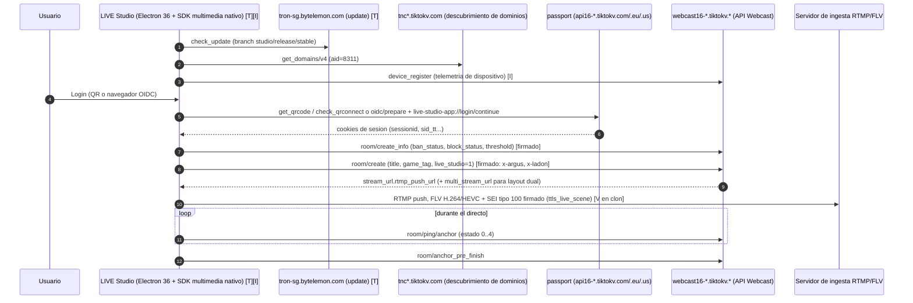

# Informe de investigación: ¿es viable una app propia en Rust equivalente a TikTok LIVE Studio?

Fecha: 2026-10-16. Alcance: solo investigación, no se construyó nada. No es asesoría legal.

Documentos de soporte (mismo directorio):
- `analisis_instalador.md`: playbook con `rea`, evidencia pública e indirecta sobre el instalador, licencias.
- `estado_del_arte.md`: fichas por repo, matriz viable/no viable, 12 huecos de captura.

Convención de confianza usada en todo el informe:
**[V]** verificado en código, git, docket o API leída en esta sesión. **[F]** documentación oficial leída (TikTok, socios, Euler). **[T]** reportado por terceros. **[I]** inferencia mía. **[BINARIO]** no existe ningún dato de este tipo: el instalador no se pudo analizar.

---

## 1. Resumen ejecutivo

1. **El instalador oficial no se pudo descargar**: la red del entorno bloquea `tiktok.com`, los CDN de TikTok y `web.archive.org` (403 en CONNECT). No hay análisis binario; lo que sabemos de Live Studio es público o indirecto (ver sección 3).
2. **Una app propia en Rust es viable si se separa en capas**: captura, codificación y push RTMP son ingeniería normal con crates activos (`windows-capture`, `wasapi`, `ffmpeg-next`, `libobs-rs`).
3. **Obtener la stream key "como lo hace Live Studio" NO es viable** con tus reglas: el cliente oficial firma peticiones (`x-argus`, `x-ladon`) e incrusta una atestación SEI en el vídeo; el único proyecto activo que lo imita suplanta al cliente con un firmador cerrado de pago y dispositivos falsos.
4. **La vía limpia para la key** es que el usuario pegue Server URL y Stream Key desde LIVE Center, o una integración oficial como socio de TikTok (no verificado que exista programa público).
5. **Eventos del live (chat, regalos)**: protocolo conocido (WebSocket + protobuf), pero la firma es una carrera de mantenimiento permanente y casi todos dependen de Euler Stream. No existe API oficial pública para esos datos [T].
6. **Riesgos principales**: ban o restricción de cuenta ("Integrity and authenticity"), ToS de TikTok que prohíben ingeniería inversa y automatización, y GPL: hay un **pleito activo Wizards of OBS v. ByteDance** (juicio fijado para 2027-10-18) sobre código de OBS dentro de Live Studio.
7. **Decisión de licencia pendiente tuya**: libobs vía bindings obliga a GPL (los crates `libobs`/`libobs-wrapper` son GPL-3.0); un pipeline propio permite licencia cerrada si se evitan x264/x265/GPL.
8. **Hueco crítico a resolver antes de escribir código**: ¿TikTok acepta una key de LIVE Center empujada por un RTMP propio u OBS sin la atestación SEI? Fuentes se contradicen (sección 6.1). Lo resuelves tú con una prueba de 10 minutos en OBS.

---

## 2. Qué se hizo y qué no (transparencia)

| Paso | Estado | Detalle |
|---|---|---|
| 1. Clonar `rea` y leer README | Hecho | Clonado en `/tmp/claude-0/work/rea`; instalado `rea-agents@6.5.0` y verificado con artefactos sintéticos. Linux sin Ghidra/Hopper/IDA/tshark; `rea` no desempaqueta NSIS/Inno/MSI (se usan 7-Zip, innoextract, msitools, instalados). |
| 1. Descargar instalador, SHA256 y versión | **Bloqueado** | 403 en CONNECT a `www.tiktok.com`, `livecenter.tiktok.com`, `lf16-*.ttwstatic.com`, `*.tiktokcdn.com`, `web.archive.org`. No se usaron mirrors de terceros (regla: solo instalador oficial). Pendiente: **tú adjuntas el archivo**. |
| 2. Análisis del instalador | **Parcial** | `analisis_instalador.md`: playbook de 12 pasos listo para ejecutar con el binario, plantilla del informe, hipótesis H1 a H7 y evidencia pública/indirecta. Estado explícito: "Análisis binario: NO realizado". |
| 3. Estado del arte | Hecho | `estado_del_arte.md`: 10 repos, 8 puntos por repo, tabla comparativa, matriz, huecos. Fechas de commit y licencias re-verificadas por mí con `git` y `LICENSE`. |
| 4. Informe final | Este documento | |

Decisiones por defecto que tomé ante ambigüedad: (a) no usar mirrors no oficiales; (b) citar el clon `TikTokStreamKeyGenerator` solo como evidencia del comportamiento del cliente, sin ejecutarlo ni replicarlo; (c) tratar toda afirmación de terceros como [T] hasta tener captura; (d) dejar la elección GPL vs cerrado como decisión tuya.

---

## 3. Flujo de TikTok LIVE Studio según lo hallado

**Advertencia:** ningún paso está verificado en binario. Proviene del clon `Loukious/TikTokStreamKeyGenerator` (que imita al cliente; citas archivo:línea en `analisis_instalador.md` sección 7) y de fuentes públicas. Confianza global: media-baja hasta capturar tráfico real.



Resumen en texto (por si el visor no renderiza Mermaid):

```
Login (QR/OIDC) -> sesion TikTok
   -> room/create_info (elegibilidad: ban, block, locale, umbral de 25 min x sesiones)
   -> room/create [peticion firmada] -> rtmp_push_url + stream key
   -> captura (SDK nativo) -> codificacion -> FLV -> RTMP push con SEI firmado
   -> ping/anchor periodico -> anchor_pre_finish
```

Datos concretos que respaldan el diagrama (todos [V] en el clon, [I] respecto al cliente oficial):
- Identidad: `aid=8311`, `app_name=tiktok_live_studio`, `channel=studio`, UA `TikTokLIVEStudio/1.27.0 Chrome/136 Electron/36.4.0 TTElectron/36.4.0-alpha.17`.
- Dominios: `*.tiktokv.com|eu|us`, `tron-sg.bytelemon.com` (update; el mismo que un dev de OBS citó en 2021 [T]), `tnc*` para TNC.
- Login: QR (`/passport/web/get_qrcode/`) u OIDC con esquema de URL `live-studio-app://login/continue`.
- Ingesta: `rtmp://` (no se observa RTMPS, WHIP ni SRT), H.264 y HEVC en FLV, SEI tipo 100 con JSON (`live_sei_game_moment`, `ttls_live_scene`, `signResult`...).
- Arquitectura probable [T][I]: UI Electron más "MediaSDK" nativo fuera de proceso (`mediasdk_server.exe`, `LSVCam.dll` como cámara virtual). Que ese SDK conserve código derivado de libobs en 2026 es **desconocido**.

---

## 4. Qué es viable y qué no

Criterio: tus reglas fijas (no evadir captcha ni antiabuso, no falsificar elegibilidad, no usar cuentas o credenciales de terceros).

### 4.1 Obtención de la stream key

| Opción | Veredicto | Motivo | Conf. |
|---|---|---|---|
| El usuario copia **Server URL + Stream Key** de LIVE Center / "Cast to PC" y los pega en tu app | **Viable** | Flujo documentado por TikTok y socios; la cuenta debe ser elegible (18+, ~1.000 seguidores, varía por región). TikTok cita a OBS como destino aceptado ("download LIVE Studio or OBS Studio"). | [F][T] |
| Integración oficial como socio de TikTok (OAuth, estilo Streamlabs/SE.Live/Restream) | **Desconocido, potencialmente viable** | No encontré programa público; la elegibilidad la decide TikTok. | [I] |
| Token de Streamlabs + API privada `streamlabs.com/api/v5/slobs/tiktok/stream/start` | **Viable con reservas, no recomendado** | Técnicamente simple; usa la cuenta de Streamlabs, suplanta su UA, depende de la whitelist y de revocaciones (política 50% juegos desde 2025-07-07). | [V][F] |
| Replicar `room/create` de LIVE Studio (aid 8311, `device_register` falso, `x-argus`/`x-ladon` por firmador, SEI `live_studio` firmado) | **NO viable** | Suplanta al cliente oficial, fabrica identidad de dispositivo y falsifica atestación. El propio autor del clon admite restricción de visibilidad sin esa firma. | [V] |
| "Spoofing" para cuentas sin acceso a Live Studio | **NO viable** | Falsifica elegibilidad. | [V] |
| Comprar keys/acceso vía agencias | **No recomendable** | Sin base oficial verificada. | [T] |

### 4.2 Eventos del live (chat, regalos, likes, viewers)

| Opción | Veredicto | Motivo | Conf. |
|---|---|---|---|
| Cliente WebSocket + protobuf con **firma por proveedor externo configurable** (Euler u otro) | **Viable con riesgos** | Funciona hoy en los repos activos; dependencia de tercero (429, 3 incidentes públicos en 13 meses), ToS contra automatización. | [V][T] |
| WebSocket directo con cookie `ttwid`, sin firma (modelo `PirateTok/live-rs`) | **Probablemente viable, sin verificar** | Código leído; funcionamiento real hoy no probado; el repo Python/Node sigue pidiendo firma. | [V]/[I] |
| Eventos de **tu propio** directo con tu propia sesión local | **Viable con riesgos** | Menor riesgo de cuenta; no enviar `sessionid` a terceros. | [I] |
| Enviar `sessionid` a un firmador de terceros | **No recomendable** | Las propias librerías lo marcan "risky operation". | [V] |
| Enviar chat/likes/regalos por rutas premium de Euler | **No viable** aquí | Credencial a tercero y automatización de acciones. | [V][I] |
| API oficial de TikTok para chat/regalos | **No existe públicamente** | Afirmado por Euler y StreamElements; sin verificar en developers.tiktok.com. | [T] |

### 4.3 Captura, codificación y salida en Rust

Esta capa **no depende de TikTok** y es la parte más viable.

| Función | Componente | Estado (crates.io, 2026-10-16) | Notas |
|---|---|---|---|
| Captura de ventana/monitor | `windows-capture` 2.0.1 (MIT) | Actualizado 2026-08-08, 2,1 M descargas | Windows Graphics Capture. Juegos en pantalla completa exclusiva pueden requerir DXGI o el hook de game capture de OBS [I]. |
| Captura alternativa | `scap` 0.1.0-beta.1 | 2025-08-04 | Beta, multiplataforma. |
| Audio | `wasapi` 0.26.0 / `cpal` 0.18.2 | 2026-10-11 / 2026-08-16 | Loopback WASAPI para audio del sistema. |
| Codificación HW | Media Foundation (crate `windows` 0.62.2) o `ffmpeg-next` 9.0.0 con `h264_nvenc`/`qsv`/`amf` | `ffmpeg-next` 2026-08-05 (WTFPL, pero FFmpeg depende del build) | NVENC/QSV/AMF se cargan del driver: no se redistribuyen. |
| Codificación SW | `openh264` 0.9.9 (BSD-2) | 2026-10-15 | Evitar `x264` (GPL; el crate `x264` 0.5.0 sin updates desde 2022-12). |
| RTMP | `rml_rtmp` 0.8.0 (MIT) | **2023-04-29** | Protocolo sin mantenimiento reciente; RTMPS (TLS), reconexión y FLV muxing habría que escribirlos. |
| Todo en uno | `libobs-simple`/`libobs-wrapper` 9.0.4+32.0.2 (**GPL-3.0**) | 2026-01-07; repo con ~140 commits desde 2026-01-01, último 2026-09-05 | Incluye captura, encoders, servicios RTMP, replay buffer. API inestable; macOS no funciona. |

Función de Live Studio que **no** se puede replicar sin su sesión: layout dual (necesita `multi_stream_url` de `room/create`), umbrales de funciones por cuenta, y cualquier cosa atada a la atestación del cliente oficial.

---

## 5. Riesgos

### 5.1 Legales y de licencia

| Riesgo | Detalle | Fuente |
|---|---|---|
| **GPL / OBS en Live Studio** | Dic 2021: devs de OBS afirmaron que la beta contenía código derivado de OBS (`GameDetour64.dll`, `Inject64.exe`, `MediaSDKGetWinDXOffset64.exe` vs `graphics-hook64.dll`, `inject-helper64.exe`, `get-graphics-offsets64.exe`). **2025-03-10: Wizards of OBS, LLC demandó a ByteDance/TikTok** (C.D. Cal. 5:25-cv-00636). MTD 1 denegado 2025-10-01; MTD 2 concedido en parte 2026-03-04; juicio con jurado fijado 2027-10-18. Los hechos de fondo son alegaciones. | Justia, PacerMonitor, ip-feed, Law360, HN, Engadget, Verge, FOSSA |
| **Licencia de tu producto si usas libobs** | libobs es GPL-2.0-or-later; `libobs`/`libobs-wrapper` de Rust son GPL-3.0. Enlazarlos exige publicar fuente completa bajo GPL y oferta de código. Separar en procesos distintos ("mera agregación") es jurídicamente discutible. | crates.io, README libobs-rs, GPLv2 |
| **Licencias de los repos de eventos** | `TikTokLive` (Python) y `TikTok-Live-Connector` (Node) pasaron el 2026-07-11 de MIT a "AGPL-3.0 modificada" con secciones 18 a 21 (permiten integración comercial salvo SaaS/relay/API cerrada; exenciones nominales a TikFinity y Euler). Portar su código = obra derivada. El mantenedor dio aprobación informal para apps de escritorio en el issue #332 (2026-09-20), que **no** enmienda la licencia. | `LICENSE` líneas 664-715 [V]; issue #332 [T] |
| **Esquema protobuf** | `TikTok-Webcast-Protobuf`: LICENSE AGPL, pero el README dice "non-commercial use only". Contradicción sin resolver. | [V] |
| **Sin licencia** | `Loukious/TikTokStreamKeyGenerator` no tiene `LICENSE`: derechos reservados, no copiar código. | [V] |
| **ToS de TikTok** | Prohíben ingeniería inversa/descompilación, scraping con bots y eludir medidas de acceso; las Community Guidelines prohíben "tools designed to bypass our systems" y crear versiones propias basadas en ingeniería inversa. **Analizar el instalador y usar endpoints no documentados roza esas cláusulas** (riesgo contractual y de cuenta; la licitud de la ingeniería inversa por interoperabilidad depende de jurisdicción: consultar abogado). | [F] páginas legales de TikTok |
| Marca | "OBS" y "TikTok" son marcas: no usar nombres ni logotipos. | [I] |

### 5.2 Ban y cuenta

- Reportes de usuarios del generador de Live Studio: baneo (#23), shadowban (#32, #37, #42, #44), restricción "Integrity & Authenticity" (#59, #66: 4 meses en todas las cuentas) [T].
- Revocación del acceso LIVE vía socios (Streamlabs #114, #122; política del 50% de juegos) [F][T].
- Detección de dispositivo: `DEVICE_BLOCKED` en el handshake, "200 en vez de 101 = detected by TikTok" [V].
- Mitigación: usar siempre **tu cuenta**, solo flujos manuales o de socio, nada de rotación de UA/IP/ttwid, nada de dispositivos falsos.

### 5.3 Mantenimiento

| Factor | Evidencia |
|---|---|
| Firma de requests cambia varias veces al año (`X-Bogus`, `X-Gnarly`, `a_bogus`; algoritmo 5.1.0 en 2025-05 a 5.3.2 en 2026-09-13) | [T] |
| Roturas recientes: protobuf v2/v3 (TikTokLive #357, 2026-03), `user_not_found` (Node #323, 2026-05), ws-fallback rechazado (#376/#379, 2026-09), lista de regalos exige firma (Node, 2026-06-14) | [V][T] |
| Punto único de fallo: firmador de un tercero (Euler: 429, caídas) o RapidAPI (plan gratuito ~1 h/día en el clon de Live Studio) | [T] |
| Proyectos abandonados: TikTokLiveSharp (último commit 2025-01-28), TikTokLiveRust de jwdeveloper (2024-08-31, archivado), gotiktoklive (2025-09-14) | [V] |
| Rust joven: `PirateTok/live-rs` (0BSD, creado 2026-04-04, 32 commits, 1 autor) | [V] |
| Parámetros frágiles: `version_code`, prefijo `Mozilla/` en UA del `wss://`, cabecera `Origin` | [V] |

---

## 6. Hallazgos que cambian decisiones

### 6.1 La contradicción sobre la key (la más importante)

- `Loukious` afirma que TikTok **cierra de inmediato** las conexiones de OBS con la key real y que, sin metadatos de Live Studio, el directo recibe restricción de integridad [V README][T baja-media].
- Las guías públicas y TikTok mismo describen OBS con key de LIVE Center como flujo normal [F][T].
- Hipótesis [I]: la key de LIVE Center es distinta de la que genera `room/create` de Live Studio, y los casos de restricción vienen de keys generadas fuera de LIVE Center. Si es así, tu app solo necesita aceptar la key pegada.
- **Prueba decisiva (la haces tú, sin código):** con una cuenta elegible, copiar Server URL y Key de LIVE Center a OBS, empezar un directo de 5 minutos y verificar que no hay restricción ni corte. Registrar resultado y captura.

### 6.2 Dos licencias que parecían simples
- Los clientes de eventos más usados ya **no son MIT**. Si pensabas portar su lógica a Rust, hay que reescribir desde capturas propias o pedir permiso escrito. `PirateTok/live-rs` (0BSD) sí es una referencia de arquitectura reutilizable.
- El camino "rápido" con libobs te obliga a **GPL** (y a un modelo de distribución con fuente).

---

## 7. Arquitectura recomendada y stack Rust

### 7.1 Principio: capas con contratos estrechos

Así el valor se entrega aunque `events` o `credentials` fallen (TikTok cambia sin aviso).

```
┌──────────────────────── UI (a evaluar: Tauri 2 / egui / iced) ───────────────────────┐
│  escenas, fuentes, mezclador, preview, panel de eventos opcional                      │
└───────┬───────────────┬───────────────────┬───────────────────┬──────────────────────┘
        │               │                   │                   │
   capture          encode              ingest             credentials / events
 (windows-capture  (MF / NVENC-QSV-AMF  (FLV mux + RTMP/S   (trait CredentialSource:
  + WASAPI +        via driver; OpenH264  + reconexion +      ManualPaste | PartnerOAuth)
  mezcla)           como fallback)        metricas)          (trait EventSource + Signer:
                                                              Unsigned | ExternalProvider)
```

Reglas:
1. `capture`, `encode`, `ingest` no importan nada de TikTok; reciben `(url, key)`.
2. `credentials`: primera implementación = **entrada manual** con validación (formato, `rtmp://` vs `rtmps://`, expiración). Una integración oficial futura se enchufa detrás del mismo `trait`.
3. `events`: opcional y apagado por defecto. Provider intercambiable; parámetros volátiles (`version_code`, UA, hosts) como configuración actualizable, no compilados.
4. Protobuf con `prost` conservando campos desconocidos y bytes crudos (`UnknownEvent`); esquema mínimo derivado de **tus** capturas; tests con capturas grabadas y reproducidas (como `record_capture`/`replay_capture` de PirateTok).
5. Credenciales en el Almacén de credenciales de Windows (DPAPI), nunca JSON plano; nunca enviar `sessionid` a terceros por defecto.
6. Firmar el ejecutable (Authenticode): hay reportes de falsos positivos antivirus con binarios empaquetados (#30 en el generador).
7. Límites explícitos: nada de resolución de CAPTCHA, rotación de huellas/UA/IP, registro de dispositivos falsos ni SEI falsificado.

### 7.2 libobs vía bindings frente a pipeline propio

| Criterio | libobs vía `libobs-simple` / `libobs-wrapper` | Pipeline propio |
|---|---|---|
| Licencia resultante | **GPL** (crates GPL-3.0 + libobs GPL-2.0+) | Libre elección (MIT/Apache/cerrada) si se evita x264/x265/FFmpeg GPL |
| Tiempo hasta primer directo | Corto: captura de juego, encoders, servicio RTMP, replay buffer ya hechos | Largo: RTMP/FLV/reconexión, mezcla de audio, game capture a construir |
| Captura de juegos (hook) | Incluida (plugin de OBS) | WGC cubre mucho; pantalla completa exclusiva requiere trabajo extra [I] |
| Madurez Rust | API "inestable" según su README; async eliminado; macOS no | Tú controlas la API; riesgo de bugs propios |
| Distribución | Debes redistribuir/descargar binarios OBS (`libobs-bootstrapper`/`cargo-obs-build` usan binarios firmados de OBS) y ofrecer fuente | Binario propio, dependencias dinámicas bajo LGPL |
| Riesgo de pleito/imagen | Bajo si cumples GPL | Bajo |
| Soporte plugins OBS | Sí | No |

**Recomendación:**
- Si el producto será **open source (GPL aceptable) o de uso personal**: empezar con `libobs-simple` es el camino más corto y fiable; reservar `libobs-wrapper` si necesitas escenas y fuentes dinámicas.
- Si será **cerrado o comercial**: pipeline propio por capas (tabla 4.3), con Media Foundation o FFmpeg LGPL dinámico, y RTMP/FLV propio sobre `rml_rtmp` o escrito a medida.
- En cualquier caso, **no mezclar**: un prototipo con libobs no debe reutilizarse en una base cerrada.
- Antes de decidir, la prueba de la sección 6.1 con OBS ya instalado (cero código) valida el riesgo mayor.

### 7.3 Entregables por fases (cuando des luz verde)

| Fase | Contenido | Puerta de salida |
|---|---|---|
| 0 | Prueba manual de key LIVE Center con OBS; captura de tráfico de Live Studio; inventario del instalador con el playbook | Hueco 2 resuelto; decisión GPL vs cerrado |
| 1 | `capture` + `encode` + `ingest` con key pegada; métricas y reconexión | Directo estable de 1 h en cuenta propia |
| 2 | Escenas, mezclador, preview, ajustes de salida | Paridad básica con OBS simple |
| 3 | `events` opcional con provider enchufable y reproducción de capturas | Cliente tolerante a cambios de esquema |
| 4 | Distribución firmada, actualizaciones, telemetría local | Instalador reproducible |

---

## 8. Datos que solo tú puedes aportar (en tu PC)

Prioridad alta primero. Hacer todo con **tu cuenta**, tu Live Studio oficial y sin intentar reproducir firmas.

1. **El instalador oficial** descargado de la web de TikTok (nombre original del archivo) y su versión. Sin esto no se puede completar el Paso 2.
2. **Prueba de la key de LIVE Center en OBS** (sección 6.1): resultado, duración, mensaje de restricción si aparece, y país de la cuenta.
3. **Captura de tráfico de Live Studio con mitmproxy** (o Fiddler/pcap): secuencia al iniciar un directo (`room/create_info`, `room/create`, `room/ping/anchor`, `anchor_pre_finish`), cabeceras presentes, formato exacto de `rtmp_push_url` (rtmp o rtmps, puerto, vigencia). Anotar si falla por certificate pinning. Para el tráfico RTMP que no pasa por HTTP: `pktmon`/Wireshark. No compartir cookies ni `sessionid`; marcar tokens como sensibles.
4. **Carpeta instalada** comprimida (`C:\Program Files\TikTok LIVE Studio\<versión>\`), **sin** `AppData\Roaming\TikTok LIVE Studio` (contiene sesión).
5. **Capturas de pantalla**: "Your LIVE access" (elegibilidad), "Acerca de"/avisos de código abierto, ajustes de salida (encoder, bitrate, resolución, protocolo).
6. **Respuesta de `room/create_info`** de tu cuenta (campos `ban_status`, `block_status`, `golive_locale_restricted`, umbral) para conocer tu elegibilidad real.
7. **Parámetros de ingesta que acepta TikTok**: codecs, bitrate y resolución máximos, intervalo de keyframe, audio.
8. **Para eventos**: si un WebSocket anónimo con `ttwid` funciona hoy desde tu IP/región, y qué eventos requieren sesión del anfitrión (`ENVELOPE`, regalos, viewers).
9. **Programa oficial de partners/API LIVE**: revisar developers.tiktok.com y, si aplica, contactar a TikTok.
10. **Requisitos de producto**: ¿open source (GPL aceptable) o cerrado/comercial?, ¿uso personal o distribución?, ¿qué funciones de Live Studio quieres replicar de verdad?
11. **Autorización** si quieres análisis dinámico en una VM desechable o instalar Ghidra/Hopper (no lo hice sin tu decisión).
12. Log local de Live Studio, redactado (módulos cargados, codificador usado).

---

## 9. Qué hacer a continuación (sin construir nada)

1. Adjuntar el instalador y/o carpeta instalada: se ejecuta el playbook (`analisis_instalador.md`, sección 4) y se completa el `[BINARIO]`.
2. Hacer la prueba 6.1 y aportar la captura de tráfico (sección 8).
3. Decidir licencia (GPL o cerrada): determina libobs vs pipeline propio.
4. Con eso, cerrar este informe con una versión 2 y definir el MVP de la Fase 1.

Detenido aquí, como pediste.

---

## 10. Fuentes citadas

### Repositorios (clonados y leídos localmente, sin ejecutar)
- https://github.com/morluto/rea (README y docs; `rea-agents` 6.5.0 en npm: https://registry.npmjs.org/rea-agents)
- https://github.com/Loukious/TikTokStreamKeyGenerator (HEAD `373407f`, 2026-09-07; sin LICENSE)
- https://github.com/Loukious/StreamLabsTikTokStreamKeyGenerator (HEAD `ef03fb2`, 2026-04-01; GPL-3.0)
- https://github.com/Loukious/obs-multi-rtmp
- https://github.com/isaackogan/TikTokLive (HEAD `fc73b8f`, 2026-09-09; AGPL modificada)
- https://github.com/zerodytrash/TikTok-Live-Connector (HEAD `8a92330`, 2026-09-22; AGPL modificada)
- https://github.com/frankvHoof93/TikTokLiveSharp (HEAD `edbcb27`, 2025-01-28; MIT)
- https://github.com/PirateTok/live-rs (HEAD `ee60855`, 2026-10-04; 0BSD)
- https://github.com/jwdeveloper/TikTokLiveRust (HEAD `5b7950c`, 2024-08-31; archivado)
- https://github.com/steampoweredtaco/gotiktoklive (HEAD `3be247c`, 2025-09-14)
- https://github.com/isaackogan/TikTok-Webcast-Protobuf (HEAD `8e7ccad`, 2026-09-28)
- https://github.com/libobs-rs/libobs-rs (último commit 2026-09-05; GPL-3.0)
- Issues citados: Loukious/TikTokStreamKeyGenerator #23, #36, #59, #66, #68, #72, #75, #76; Loukious/StreamLabsTikTokStreamKeyGenerator #114, #122, #134, #139; isaackogan/TikTokLive #336, #342, #349, #357, #376, #379; zerodytrash/TikTok-Live-Connector #310, #323, #327, #328, #332; frankvHoof93/TikTokLiveSharp #95, #108, #118 (URLs completas en `estado_del_arte.md` sección 12)

### Crates (API de crates.io consultada el 2026-10-16)
- https://crates.io/crates/libobs-wrapper , /libobs , /windows-capture , /scap , /ffmpeg-next , /openh264 , /rml_rtmp , /tokio-tungstenite , /prost , /wreq , /wasapi , /cpal , /x264

### Legal y licencias
- Docket Wizards of OBS v. ByteDance: https://dockets.justia.com/docket/california/cacdce/5:2025cv00636/961274 , https://www.pacermonitor.com/public/case/57173804/Wizards_of_OBS,_LLC_v_Bytedance_Ltd_et_al , https://ip-feed.com/case/2913 , https://www.law360.com/cases/67cfbf4066b943af3088b060/articles
- Declaración de la abogacía demandante (2026-03-07): https://www.linkedin.com/feed/update/urn:li:activity:7435838059407093760
- Disputa 2021: https://news.ycombinator.com/item?id=29592103 , https://www.engadget.com/tiktok-gpl-violation-obs-163509367.html , https://www.theverge.com/2021/12/20/22847213/tiktoks-live-studio-obs-open-source-policy , https://fossa.com/blog/does-tiktok-live-studio-violate-the-gpl-v2/
- OBS backend: https://docs.obsproject.com/backend-design ; foro de OBS sobre incrustar OBS: https://obsproject.com/forum/threads/obs-license-infringement.141405/
- TikTok ToS y políticas: https://www.tiktok.com/legal/page/us/terms-of-service/en , https://www.tiktok.com/community-guidelines/en/integrity-authenticity , https://www.tiktok.com/community-guidelines/en/privacy-security , https://www.tiktok.com/community-guidelines/en/accounts-features , https://www.tiktok.com/privacy/blog/how-we-combat-scraping/en , https://www.tiktok.com/legal/page/global/tik-tok-developer-terms-of-service/en

### Elegibilidad y socios
- https://support.tiktok.com/en/live-gifts-wallet/tiktok-live/what-is-tiktok-live
- https://support.tiktok.com/en/live-gifts-wallet/tiktok-live/moderating-on-tiktok-live
- https://support.tiktok.com/en/safety-hc/account-and-user-safety/age-requirements-for-tiktok-live
- https://www.tiktok.com/live/studio/help/article/Before-you-go-LIVE/Apply-for-LIVE-access
- https://www.tiktok.com/live/studio/help/article/FAQ/FAQ
- https://www.tiktok.com/live/creators/en-US/article/tiktok-live-studio-access_en-US
- https://streamlabs.com/platforms/tiktok , https://support.streamlabs.com/hc/en-us/articles/35259691237147-Streamlabs-x-TikTok-Streaming-Access-Revoked-Suspended
- https://support.streamelements.com/hc/en-us/articles/18771457842066-SE-Live-The-Complete-Guide-Setup-Features-Multistreaming-Troubleshooting
- https://restream.io/integrations/tiktok/

### Firma y eventos
- https://www.eulerstream.com/docs/signatures , /docs/api/rate-limits , /docs/sign-server/custom-sign-servers , /docs/captchas/captcha-extension , /pricing
- https://developers.tiktok.com/docs/en/webhooks-overview (webhooks generales; no verificado si cubren LIVE)

### Notas de método
- Búsquedas web con WebSearch y Exa; WebFetch directo no resolvía los dominios bloqueados. Las páginas oficiales de TikTok y Euler se leyeron mediante copias de texto de Exa.
- Cifras de commits en 12 meses calculadas con `git log --since=2025-10-16`; licencias leídas de `LICENSE` en cada clon.
